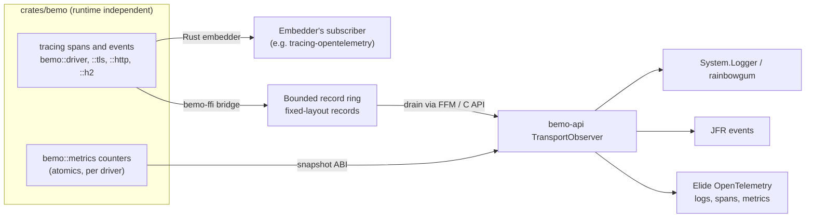

# Transport observability design

Status: proposed, 2026-10-11. Decisions marked **(decide)** need sign-off before
any ABI or cross-repository work starts.

## Problem

Elide exposes logging, tracing, metrics, and profiling through OpenTelemetry.
Bemo moves the hot path (sockets, TLS, HTTP/1, HTTP/2, compression) into Rust,
where the JVM's instrumentation cannot see it. Today:

- The Rust core has no structured diagnostics: two `eprintln!` calls.
- `h2` already emits `tracing` events inside Bemo's process, and nothing collects them.
- The JVM side has three opt-in JFR events (`TransportEvents`): batch, TLS
  handshake, and staging copy. They are useful for profiling, but they are not
  logs, spans, or metrics, and they do not exist for Rust-only embedders.
- Native HTTP requests carry no trace context, so a native exchange cannot join
  the JVM span that handles it.

Constraints from `AGENTS.md`: `crates/bemo` must not depend on JVM, Netty,
GraalVM, or Elide runtime types; capabilities are advertised only after their
data plane and ownership tests exist; ABI changes update both bindings and
their shared contract.

## Goals

1. **Rust embedders** (Elide's Rust layer) install their own subscriber and
   see Bemo spans and events with no Bemo-specific glue.
2. **JVM embedders** (FFM and Native Image) receive the same records and route
   them to `System.Logger`, rainbowgum, JFR, or OpenTelemetry.
3. **Trace continuity**: a native exchange or socket operation can carry the
   W3C trace context of the JVM span that owns it, and the reverse.
4. **Metrics** for transport state (bytes, operations, handshakes, errors,
   budget use, backend fallbacks) are readable without enabling logs.
5. **Zero cost when off**: disabled call sites cost a relaxed load and a branch;
   release builds can compile verbose levels out entirely.
6. **No callbacks from owner threads into the JVM.** Driver callbacks may respond,
   close, or release (see `crates/bemo/AGENTS.md`); a logging upcall must never
   add reentrancy there.

Non-goals: an OTLP exporter inside `crates/bemo`, and sampling policy. Both
belong to the embedder.

## Design



### 1. Instrument the Rust core with `tracing` (decide: facade)

Recommendation: use `tracing` 0.1 in `crates/bemo`, with `default-features = false`
and `std`. It is already in the graph through `h2`, has no runtime dependency,
and is what Rust embedders, including Elide, already subscribe to.

- Targets follow modules: `bemo::driver`, `bemo::tls`, `bemo::http`, `bemo::h2`,
  `bemo::abi`, `bemo::alloc`.
- Spans: `socket` (driver, socket, workload, backend), `tls.handshake` (role,
  version, cipher suite, ALPN, outcome), `http.exchange` (version, method,
  status, bytes in and out), and `h2.stream`. Spans are created only where a
  lifetime already exists in the code, so there is no extra allocation per byte.
- Events: backend selection and AUTO fallback reasons (replacing `eprintln!`),
  TLS failures (alert, not payload), protocol errors and the status answered,
  budget exhaustion, cancellation versus completion, and stalls such as the H2
  flow-control force-reset.
- Never record payloads, header values, peer certificates, or key material.
  Endpoint addresses only at `debug` and above, behind a field-level opt-in.
- Cargo features `observe-max-info` and `observe-off` map to `tracing`'s
  `max_level_*` features for release builds.

The alternative is custom macros writing straight into the ring. That avoids a
facade, but Rust embedders would need Bemo-specific glue, and `h2`'s events
would still need a `tracing` subscriber.

### 2. Bridge to the JVM through a drained ring (decide: delivery)

`bemo-ffi` (not `crates/bemo`) installs, on request, a `tracing` subscriber
layer that encodes records into a bounded multi-producer ring:

- Records are fixed 64-byte headers: timestamp, level, kind (event, span enter,
  span exit, span close), target id, callsite id, thread id, span id, parent span
  id, trace context, and a field-arena offset. Variable data (the message and up
  to 8 key/value pairs, truncated) goes into a per-record arena slot.
- Callsite metadata (target, name, file, line, field names) is interned once and
  delivered as a separate `callsite` record, so steady-state records carry ids.
- A full ring drops the record and increments a `dropped` counter that is
  reported with the next drain. Producers never block and never allocate.
- The JVM drains the ring from a dedicated daemon thread, or piggybacks on
  `NativeIoHandler`'s poll loop, never from inside a driver callback.

New ABI, behind capability bit `CAP_OBSERVE_V1`, advertised only once the
ring's ownership and overflow tests exist:

```c
int32_t  bemo_observe_configure(uint32_t max_level, uint64_t ring_bytes);
int64_t  bemo_observe_drain(void *dest, uint64_t capacity);   /* bytes written */
int32_t  bemo_observe_metrics(uint64_t driver, void *dest, uint64_t capacity);
int32_t  bemo_observe_context(uint64_t driver, uint64_t handle,
                              const uint8_t trace_id[16], uint64_t span_id,
                              uint8_t flags);
```

Upcalls (FFM upcall stubs or Native Image `@CEntryPoint`) were rejected. They
would run Java on owner threads in the middle of driver operations, attaching
threads costs microseconds, and an exception or a blocking appender would stall
I/O.

### 3. JVM side: `TransportObserver`

`bemo-api` gains a small, dependency-free `TransportObserver` SPI that receives
decoded records and metric snapshots. Bemo ships adapters, each optional:

- `SystemLoggerObserver` (JDK only) maps levels and targets to `System.Logger`.
  rainbowgum, SLF4J, and JUL users get records through their existing
  `System.Logger` bridges with no new dependency.
- `JfrObserver` turns spans into JFR events, extending today's `TransportEvents`.
- Elide supplies an OpenTelemetry observer: events become OTel log records,
  spans become OTel spans parented by the attached context, and metric snapshots
  feed asynchronous instruments. That code lives in Elide, keeping Bemo's
  published artifacts free of OTel and Elide dependencies.

### 4. Trace context

- **JVM to native:** `bemo_observe_context` attaches a W3C trace id, span id,
  and flags to a socket or HTTP exchange handle. Spans created for that handle
  use it as their remote parent. Netty adapters call it when a channel or
  exchange is associated with a current OTel context, through a hook Elide
  provides.
- **Native HTTP to JVM:** the native HTTP path parses `traceparent` and
  `tracestate` during request parsing (bounded and validated) and exposes them
  as an exchange view, so the JVM handler continues the trace without
  re-parsing headers.

### 5. Metrics

Per-driver atomics, already partly computed for JFR batches, are exposed as a
fixed snapshot layout: bytes in and out, operations by kind, completions,
errors by class, TLS handshakes by outcome, HTTP exchanges by version and
status class, H2 streams and resets, budget in use and its high-water mark, and
backend plus fallback reason. Snapshots are read on demand and never pushed.

### 6. Profiling

- Keep frame pointers in profiling builds and retain symbols in benchmark
  artifacts (already done for benchmarks). Document `perf` and async-profiler
  usage across the FFM boundary.
- Span timings in the ring double as a low-overhead native timeline that JFR
  can show next to Java samples.
- The Elide toolchain's Propeller and MemProf flows apply to Bemo's static
  library in Elide's final link; nothing Bemo-specific is needed.

## A common Rust core shared with rainbowgum (decide: home)

Elide wants one pipeline for JVM logs and native events. rainbowgum's model
(`LogEvent` → `LogRouter` → publisher → appender/encoder → output), including
its OTLP encoder, is in Java today. The proposal is a small Rust crate (working
name `gum-core`) that owns:

- the record and callsite format and the bounded ring (section 2);
- level filtering compatible with rainbowgum's `LevelResolver` semantics;
- an optional native OTLP/protobuf encoder and batching exporter.

Bemo's FFI bridge depends on it behind a feature. A new rainbowgum module
(`rainbowgum-native`) uses the same core through FFM in two ways: as a
`LogPublisher` that hands JVM `LogEvent`s to the native ring, so ordering and
batching are shared with native events, and as a source that turns native
records into `LogEvent`s for the normal Java appenders. Elide can then export
both sides through one OTLP path with one resource identity.

Options for where the core lives:

1. **A new crate and repository under elide-tools (recommended).** Bemo,
   Elide's Rust layer, and rainbowgum-native depend on one pinned revision.
   Bemo stays a transport.
2. Inside `bemo-ffi`. This is quicker, but it ties logging infrastructure to
   transport releases and puts a non-transport ABI in the transport library.
3. Upstream in rainbowgum. Its maintainers would need to accept a native
   component in a pure-Java project.

## Phasing

1. **Rust instrumentation, no ABI.** Add `tracing` spans and events, replace the
   `eprintln!` calls, and add per-driver metric atomics. Rust embedders benefit
   immediately. Tests assert field names and levels with a capturing subscriber,
   and assert that no payload bytes appear.
2. **Ring, bridge, and ABI** (`CAP_OBSERVE_V1`), with both bindings, the shared
   contract, ownership, overflow, and drop-accounting tests, and the existing
   sanitizer and fuzz coverage (a `ring` fuzz target).
3. **JVM observers and trace context**, including native `traceparent` parsing
   with a fuzz target.
4. **The shared core and rainbowgum-native**, once the record format has proven
   itself in steps 2 and 3.

## Open questions

- Should the ring be per process (simplest) or per workload (isolation and
  per-tenant budgets)?
- Can Elide accept a `tracing` dependency in the transport's public Rust API, or
  should spans stay internal with only metrics public?
- Should the native HTTP path sample on its own when the JVM attaches no
  context, or always defer to the JVM?
